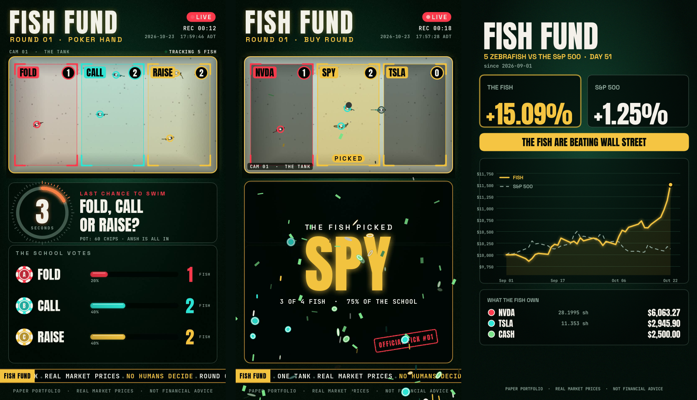

# Fish Fund

Zebrafish pick the stocks. You place the trades.

A webcam looks down on one tank. The tank is split into zones along its length, and each zone has a printed ticker card. Fish swim into a zone, the countdown ends, and the busiest zone wins. You buy or sell that name yourself at a brokerage, then log it here. The ledger compares your account with a simulated S&P 500 buy of the same starting cash.

Nothing in this project talks to a broker, and nothing sends orders.

## What a round looks like



Every round renders as a broadcast package and records straight to mp4:

- **Vertical 1080×1920 by default**, ready for Reels, TikTok and Shorts. `--layout wide` gives 1920×1080.
- Casino-felt look: gold-framed tank cam, zone targets in poker-chip colours, a fading trail behind every fish.
- A countdown ring that turns red and pulses for the last 5 seconds, plus a live leaderboard with animated bars.
- A slot-machine reveal that spins through the options and lands on the pick, then a flash, a shockwave, chip confetti, and an "OFFICIAL PICK #NN" stamp.
- A ticker tape with live prices on buy and hold rounds, and a timestamp in the header so viewers can see it is live.

Rehearse the whole thing without a camera or fish:

```bash
python pick.py --round buy --demo
python pick.py --round poker --demo --note "POT: 60 CHIPS"
```

Demo rounds render five realistic zebrafish: painted skin with blue and gold stripes, translucent fins, a spine that undulates as they swim in bursts and glides, soft shadows, and a sand floor under moving caustic light. The fish go through the real detection and graphics, and the feed is labelled SIMULATED TANK. Demo rounds draw every frame on a 30 fps clock, so the recording is smooth even when the preview runs slow. They are saved as `recordings/demo-*.mp4` and never logged.

If `ffmpeg` is installed, every round also saves an H.264 copy (`*-h264.mp4`) that Instagram, TikTok and phones accept.

## Setup

Python 3.11 or newer. The broadcast fonts (Anton, Space Grotesk, JetBrains Mono, all SIL OFL) ship in `fonts/`.

```bash
python3 -m venv .venv
source .venv/bin/activate
pip install -r requirements.txt
```

Run the commands from this directory. Data files are written next to the scripts, not into the current directory, so a full path works too.

Hardware this expects:

- One USB webcam above the tank, pointed down.
- A light tank bottom and small, dark or striped fish.
- Zones along the length of the tank. The default round uses 3. Draw more if a buy round needs more tickers.

There is no camera on a typical dev machine. `calibrate.py` and `pick.py` exit with a clear message in that case.

## Calibrate

```bash
python calibrate.py
```

The preview opens. Drag a rectangle around each zone. After each drag, the terminal asks for the ticker (`AAPL`, `VOO`, `BRK.B`). Zones you already saved are loaded on the next run.

Keys, also shown in the window title and along the bottom of the preview:

| Key | Action |
| --- | --- |
| drag | Draw a zone, then type its ticker in the terminal |
| `u` | Undo the last zone |
| `c` | Clear every zone so you can redraw |
| `s` | Save zones into `config.json` |
| `q` or Esc | Quit. If you have unsaved edits, it asks before closing |

Saving only replaces `zones`. Countdown, blob sizes, and the other settings stay as they are.

Draw order matters for the other rounds:

- Hold: the first zone is HOLD, the second is SELL.
- Size: the first three zones are 10%, 25%, and 50%.

Draw those left to right if you want the cards to match the labels. Zones should not overlap. A fish in an overlap counts for the earlier zone. Recalibrate if the camera resolution changes. Zone positions are pixels in that frame.

`--config path` reads and updates a different file.

## Blob size

`min_blob_area` and `max_blob_area` in `config.json` are the pixel area of a detected fish. Defaults are 100 and 8000, a wide band for a small fish seen from above. A zebrafish on a 720p or 1080p top-down view is often a few hundred to a few thousand pixels. Specks are smaller. Hands, reflections, and the filter are larger.

Tune while watching a round. Counted fish get a colored ring. Blobs outside every zone get a grey ring and are not counted.

- Fish never get a ring: lower `min_blob_area` (try 60, then 30).
- Gravel, bubbles, or reflections count: raise `min_blob_area`, or lower `max_blob_area`.
- Moving the camera or changing resolution changes these numbers. Tune again after that.

`background_mode` is `mog2` by default. That learns the tank from motion, which suits fish that are swimming. Fish that hover can disappear into the background. For a locked-off camera, shoot an empty tank instead:

```bash
python pick.py --capture-background
```

That saves `background.png`, sets `background_mode` to `frame`, and leaves the other settings alone. Later rounds subtract that still. If the light changes, capture it again.

## Monthly round

One round, then you trade, then you log, then you chart.

```bash
python pick.py --round buy
```

`python pick.py --round buy --video tank.mp4` plays that file through the same detection and overlay instead of the webcam.

The preview shows each zone, its ticker, a live fish count, the leaderboard, and the countdown (`countdown_seconds`, default 15). The whole round, graphics included, is saved to `recordings/<timestamp>.mp4`. When time is up, the zone with the most fish wins. If zones are tied, the higher average count over the final 3 seconds wins. If that is still tied, one of the remaining zones is chosen at random. The reveal plays for `banner_seconds` (default 7). The result is appended to `picks.csv`.

Place that trade yourself in your brokerage. Then record the fill:

```bash
python fund.py buy AAPL --amount 50
python chart.py
```

`chart.py` writes `charts/fish-fund-YYYY-MM-DD.png` (1080×1920) and prints the path. The poster is the fish account against the S&P 500 since you started.

Other rounds:

```bash
python pick.py --round hold --ticker AAPL
python pick.py --round size
python pick.py --round poker --note "POT: 60 CHIPS"
```

Poker uses the first three zones, labeled FOLD, CALL, and RAISE. Use it at a real table: run the round, then play the fish's decision.

Round options:

| Flag | Effect |
| --- | --- |
| `--layout reel` / `wide` | 1080×1920 (default) or 1920×1080 output |
| `--note "TEXT"` | A line under the question, for the pot, the stakes, the bet |
| `--footer "TEXT"` | Replace the small line at the bottom. `--footer ""` hides it |
| `--demo` | Simulated tank, nothing logged |
| `--no-prices` | Skip the price lookup (it runs in the background and never delays a round) |
| `--no-preview` | Record without opening a window |
| `--preview-scale 0.5` | Preview window size. The recording is always full size |

The recording stays in real time even if a slow machine draws fewer frames per second. The preview is only a monitor; film the mp4.

Hold uses the first two zones, labeled HOLD and SELL. The banner names HOLD or SELL, and `picks.csv` stores the ticker in the subject column. Size uses the first three zones, labeled 10%, 25%, and 50%. You still choose the dollars and place the order. If the fish pick 25%, that means 25% of whatever cash you decided to risk.

A buy round needs at least 1 zone, hold needs 2, and size and poker need 3.

## The ledger

`fund.py` only writes down what you already did.

```bash
python fund.py init --cash 200
python fund.py buy AAPL --amount 50
python fund.py sell AAPL --shares 0.1
python fund.py status
```

`init` stores the cash and a simulated SPY buy of that same cash at the latest price (`shares = cash / price`). It will not overwrite an existing `portfolio.json`.

`buy` spends dollars from cash on fractional shares at the latest price. It rejects an amount bigger than your cash. `sell` rejects a share count bigger than the holding and adds the proceeds to cash. `status` prints each holding (shares, price, value), cash, total value, fish return versus starting cash, S&P return, and who is ahead: `FISH`, `SPY`, or `TIE`.

Prices are the latest daily close from Yahoo Finance, so evenings and weekends use the last session. Dates are stored as `YYYY-MM-DD` in `America/New_York`. If a price cannot be fetched, the command says so and leaves `portfolio.json` unchanged.

Use another file by putting `--portfolio` before or after the command:

```bash
python fund.py --portfolio /tmp/book.json init --cash 200
python fund.py status --portfolio /tmp/book.json
```

`chart.py` takes the same `--portfolio` flag, plus `--output` for the PNG:

```bash
python chart.py --portfolio /tmp/book.json --output /tmp/fish-fund.png
```

The chart rebuilds the fish account from the trade history: cash and shares as of each day, valued at that day's close. The S&P line is the benchmark share count times the SPY close. A trade logged on a weekend shows up on the next close, or on that calendar date if the latest close is already behind it.

`portfolio.json`, `picks.csv`, recordings, and chart PNGs are gitignored.

## Config

`config.json` ships with empty zones and these defaults:

| Field | Default | Meaning |
| --- | --- | --- |
| `camera_index` | `0` | USB camera index |
| `countdown_seconds` | `15` | Length of a round |
| `banner_seconds` | `7` | Length of the reveal. The slot spin takes about the first third |
| `min_blob_area` | `100` | Smallest fish blob, in pixels |
| `max_blob_area` | `8000` | Largest fish blob, in pixels |
| `background_mode` | `mog2` | `mog2` or `frame` |
| `background_image` | empty | Still frame used when mode is `frame` |
| `zones` | `[]` | `{ticker, x, y, w, h}` in camera pixels |
